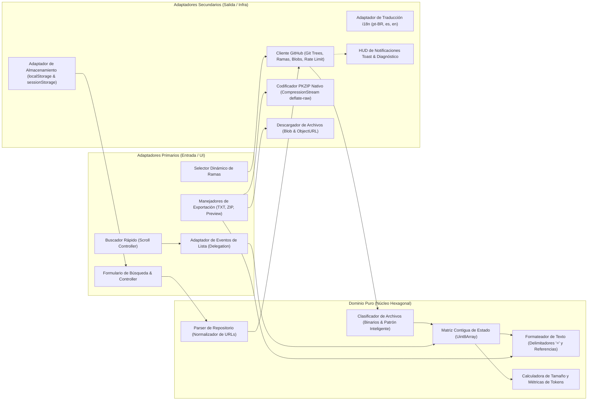

[🇺🇸 English](./README.md) | [🇧🇷 Português (Brasil)](./README.pt-BR.md) | **🇪🇸 Español**

---

# 🚀 GitHub Scrap

> **Aplicación web 100% client-side y sin dependencias (HTML5, CSS3 y Vanilla JavaScript ES Modules) lista para GitHub Pages para explorar, seleccionar y extraer código fuente de repositorios de GitHub en un único archivo `.txt` (optimizado para LLMs/IA), un archivo `.zip` nativo o mediante visualización y copia directa en pantalla.**

---

[](LICENSE)
[](#-estándares-de-ingeniería-e-invariantes)
[](#-despliegue-en-github-pages)
[](#-arquitectura-del-sistema-ports--adapters)
[](#10-rendimiento-extremo-para-alta-volumetría)

---

## 📌 Visión General

Alimentar Modelos de Lenguaje de Gran Escala (**LLMs** como Claude, GPT-4o, Gemini o DeepSeek) con el código fuente de repositorios enteros suele enfrentar fricciones operativas comunes:
* Contaminación de la ventana de contexto con archivos binarios innecesarios (imágenes, fuentes, ejecutables y archivos comprimidos `.zip`).
* Desperdicio de ancho de banda y agotamiento del límite de peticiones de la API de GitHub al intentar descargar archivos pesados que carecen de valor semántico.
* Complejidad innecesaria de herramientas CLI locales y entornos pesados (Node.js, Python, Docker) inviables en máquinas corporativas restringidas.
* Políticas corporativas de Prevención de Pérdida de Datos (**DLP**) y proxys de seguridad que bloquean la descarga directa de archivos.

**GitHub Scrap** soluciona estos obstáculos mediante una propuesta ligera, elegante y 100% nativa del navegador. Se trata de una aplicación web **estática client-side**, construida con **HTML5 semántico**, **CSS3 moderno** y **Vanilla JavaScript (ES Modules)**, sin frameworks, empaquetadores (bundlers) ni dependencias externas.

Ejecutándose en su totalidad en el navegador del usuario, GitHub Scrap consulta árboles de archivos de GitHub en tiempo real mediante la **GitHub Git Trees API**, clasifica de manera inteligente archivos de texto frente a referencias estructuradas y exporta la selección en documentos `.txt` formateados, archivos `.zip` nativos o en un visor interactivo en pantalla.

---

## ✨ Principales Características

### 1. 🌐 100% Client-Side & Zero Dependencias
* Funciona íntegramente en el navegador aprovechando las Web APIs estándares (`fetch`, `CompressionStream`, `Blob`, `URL.createObjectURL`, `localStorage`, `sessionStorage`).
* No requiere servidor backend, runtime de Node.js, paso de compilación ni gestores de paquetes (`npm`/`yarn`).
* Listo para despliegue instantáneo en plataformas estáticas como **GitHub Pages**, Cloudflare Pages, Netlify o Vercel.

### 2. 🌍 Detección Automática de Idioma (Multiidioma)
* Detecta automáticamente el idioma del navegador del usuario al iniciar (`pt-BR`, `es` o `en`), usando el inglés (`en`) como fallback predeterminado.
* Traducción dinámica de la interfaz completa: etiquetas, formularios de búsqueda, modales, descripciones emergentes, notificaciones y diagnósticos de error.

### 3. 🌿 Selección Dinámica de Rama (Branch) en Tiempo Real
* Consulta dinámicamente la API de ramas de GitHub (`GET /repos/{owner}/{repo}/branches`) y lista todas las ramas activas en un selector desplegable accesible.
* Permite cambiar de rama en tiempo real, recargando el árbol de archivos y recuperando las preferencias de selección específicas de dicha rama.
* Resuelve de forma automática la rama principal (`main`, `master` o personalizada) cuando se omite en la URL de búsqueda.

### 4. ⚡ Modos Scrap vs. Referencia & Patrón Inteligente
Extracción híbrida que equilibra el uso eficiente de tokens de IA y el tráfico de red:

| Modo | Comportamiento en Descarga | Formato en Archivo Compilado | Escenario Recomendado |
| :--- | :--- | :--- | :--- |
| **`Scrap` (Texto)** | Descarga el código fuente sin procesar mediante `raw.githubusercontent.com` o API de Blobs. | Contenido íntegro UTF-8 delimitado por encabezados estandarizados de 80 columnas. | Código fuente (`.js`, `.ts`, `.py`, `.go`, `.rs`, `.java`, etc.), documentación (`.md`, `.txt`) y configs (`.json`, `.yaml`). |
| **`Referencia`** | Cero descargas por red ($O(1)$). Extrae los metadatos directamente del árbol de Git. | Bloque estructurado con ruta, tipo, tamaño exacto en bytes, hash SHA del blob de Git, enlace web de GitHub (`blob`) y enlace directo (`raw`). | Archivos binarios, fuentes, medios audiovisuales, archivos comprimidos o archivos masivos (`> 500 KB`). |

* **Botón Patrón Inteligente:** En 1 solo clic, etiqueta automáticamente archivos binarios y cualquier archivo superior a **500 KB** como `Referencia`, manteniendo el código fuente en modo `Scrap`.
* **Protección contra Bytes Nulos:** Inspecciona el flujo de texto descargado e intercepta caracteres nulos (`\0`), evitando la inclusión involuntaria de datos binarios corruptos en el archivo de salida.
* **Control Granular y Masivo:** Permite alternar cada archivo de forma individual entre Scrap y Referencia o aplicar cambios en bloque a todo el repositorio.

### 5. 🔍 Buscador Rápido (`Ctrl+F` con Desplazamiento Suave)
* El atajo `Ctrl+F` (o `Cmd+F`) enfoca de inmediato la barra de búsqueda superior.
* Localiza el archivo coincidente en la lista activa y se desplaza suavemente (`scrollIntoView`) hasta él, sin ocultar ni desmontar los demás elementos de la vista.
* Navegue secuencialmente entre coincidencias usando `Enter` (siguiente) y `Shift+Enter` (anterior).

### 6. 📊 Estimación en Tiempo Real de Tamaño y Tokens para IA
* Panel HUD dinámico en el pie de página fijo (sticky) calcula y muestra:
  * **Archivos Seleccionados:** Conteo en tiempo real discriminando entre Scrap y Referencia.
  * **Tamaño Estimado:** Proyección matemática precisa del tamaño final compilado (`B`, `KB`, `MB`, `GB`).
  * **Tokens Estimados para LLMs:** Cálculo en tiempo real según la relación promedio de caracteres por token, facilitando el dimensionamiento exacto de prompts.

### 7. 📦 3 Formas de Exportación (Compatible con Redes Corporativas / Anti-DLP)
Diseñado para funcionar tanto en equipos personales como en entornos corporativos con restricciones severas:

1. **Generar TXT:** Descarga `<repo>.txt` con todos los archivos seleccionados, concatenados y delimitados por encabezados canónicos de 80 caracteres.
2. **Generar ZIP:** Empaqueta los archivos seleccionados respetando la estructura de carpetas original del repositorio, usando `CompressionStream('deflate-raw')` y un codificador binario PKZIP nativo sin librerías externas.
3. **Visualizar / Copiar:** Despliega el resultado compilado en un cuadro de diálogo modal accesible (`<dialog>`), ofreciendo:
   * **Copiar Todo:** Copia el texto completo al portapapeles del sistema en 1 clic.
   * **Abrir en Nueva Pestaña:** Transmite el contenido a una nueva pestaña del navegador mediante una URL temporal `Blob`, permitiendo a usuarios en redes corporativas con bloqueo de descargas (DLP) inspeccionar y guardar el archivo sin activar filtros de seguridad.

### 8. 🔑 Autenticación Opcional con Personal Access Token (PAT)
* **Límite Ampliado:** Aumenta el umbral de la API REST de GitHub de **60 peticiones/hora** a **5.000 peticiones/hora**.
* **Acceso a Repositorios Privados:** Permite explorar y descargar repositorios privados mediante cabeceras de autorización y la API de Blobs de GitHub (`GET /repos/{owner}/{repo}/git/blobs/{sha}`) con decodificación Base64.
* **Almacenamiento Local Exclusivo:** El token se guarda únicamente en el `localStorage` del navegador y se envía directamente a `api.github.com`. Ningún servidor intermediario tiene acceso a sus credenciales.

### 9. 💾 Persistencia Inteligente y Caché de Sesión
* **Persistencia de URL:** Guarda automáticamente el último repositorio consultado en `localStorage`, cargándolo en el buscador en visitas futuras.
* **Estado por Rama:** Memoriza la selección y los modos de extracción por repositorio y rama (`owner/repo@branch`).
* **Caché de Sesión:** Utiliza `sessionStorage` para almacenar en caché las respuestas del árbol de Git, evitando peticiones de red repetitivas al cambiar de pestaña o rama durante la misma sesión.

### 10. 🏎️ Rendimiento Extremo para Alta Volumetría
Optimizado para gestionar repositorios gigantescos con decenas de miles de archivos:
* **Matriz Contigua en Memoria (`Uint8Array`):** El estado de selección y modo de cada archivo se administra en arreglos tipados contiguos (`Uint8Array`), logrando lectura y escritura en tiempo estricto $O(1)$ sin sobrecargar el Garbage Collector.
* **Delegación Centralizada de Eventos:** Un único listener en `#file-list` atiende todas las interacciones de usuario en miles de filas.
* **Renderizado por Lotes:** Construcción de nodos fuera del DOM principal con `DocumentFragment`, provocando un único reflow y repaint.
* **Virtualización con CSS Moderno:** Emplea `content-visibility: auto` y `contain-intrinsic-size` para evitar el cálculo de diseño de elementos fuera de la pantalla, manteniendo un desplazamiento fluido a 60/120 FPS.
* **Pool Concurrente Controlado:** Descargas organizadas en un pool de 6 workers paralelos para evitar agotar las conexiones HTTP del navegador conservando el orden de los archivos.
* **Cancelación Atómica con `AbortController`:** Detiene de inmediato las solicitudes en tránsito cuando se inicia una nueva búsqueda.

---

## 🏗️ Arquitectura del Sistema (Ports & Adapters)

GitHub Scrap implementa fielmente la **Arquitectura Hexagonal (Ports & Adapters)** y los principios de Clean Architecture, logrando que la lógica de negocio pura resida en un Dominio Puro totalmente desacoplado de APIs del navegador y de la red.



### Detalle de Componentes

| Capa | Módulo / Archivo | Responsabilidad |
| :--- | :--- | :--- |
| **Presentación** | [`index.html`](./index.html) | Estructura semántica HTML5 accesible con formularios, barra de progreso y diálogos modales. |
| **Presentación** | [`style.css`](./style.css) | Estilizado responsivo CSS3 con tema claro/oscuro automático, barras fijas sticky y cuadrículas CSS Grid. |
| **Composition Root** | [`app.js`](./app.js) | Punto de entrada principal, cableado de dependencias e inicialización de eventos. |
| **Dominio Puro** | [`src/domain/repo-parser.js`](./src/domain/repo-parser.js) | Validación sintáctica y normalización de entradas (`owner/repo`, URLs web, git, ramas). |
| **Dominio Puro** | [`src/domain/file-classifier.js`](./src/domain/file-classifier.js) | Clasificación determinista de extensiones binarias, revisión de null-bytes y Patrón Inteligente. |
| **Dominio Puro** | [`src/domain/text-formatter.js`](./src/domain/text-formatter.js) | Formateo del archivo final con separadores de 80 columnas, bloques de referencia y estimación de tokens. |
| **Adaptador Secundario** | [`src/adapters/i18n.js`](./src/adapters/i18n.js) | Diccionarios de traducción multiidioma y detección de configuración regional (`pt-BR`, `es`, `en`). |
| **Adaptador Secundario** | [`src/adapters/github-client.js`](./src/adapters/github-client.js) | Comunicación HTTP con la API REST de GitHub (árboles, ramas, blobs y métricas de rate limit). |
| **Adaptador Secundario** | [`src/adapters/zip-encoder.js`](./src/adapters/zip-encoder.js) | Codificador binario PKZIP nativo con tabla CRC-32 y compresión por flujo `deflate-raw`. |
| **Adaptador Secundario** | [`src/adapters/storage-adapter.js`](./src/adapters/storage-adapter.js) | Abstracción tolerante a fallos para lectura y escritura en `localStorage` y `sessionStorage`. |
| **Adaptador Primario** | [`src/adapters/dom-controller.js`](./src/adapters/dom-controller.js) | Control de eventos del DOM, renderizado de listas, telemetría HUD y diálogo de previsualización. |

---

## 📄 Formato del Archivo Generado (`<repo>.txt`)

El archivo resultante utiliza un formato estandarizado con **líneas separadoras de 80 caracteres `=`** (`================================================================================`), lo que facilita la lectura y procesamiento por parte de LLMs y analizadores de texto.

### 1. Ejemplo de Bloque en Modo `Scrap` (`FILE: <ruta>`)
```text
================================================================================
FILE: src/domain/calculator.js
================================================================================
export function add(a, b) {
  return a + b;
}

export function multiply(a, b) {
  return a * b;
}
```

### 2. Ejemplo de Bloque en Modo `Referencia` (`FILE: <ruta> [REFERENCIA]`)
```text
================================================================================
FILE: assets/arquitectura.png [REFERENCIA]
================================================================================
Ruta: assets/arquitectura.png
Tipo: .png
Tamaño: 148.5 KB (152064 bytes)
SHA: 4b825dc642cb6eb9a060e54bf8d69288fbee4904
GitHub View: https://github.com/owner/repo/blob/main/assets/arquitectura.png
Download Raw: https://raw.githubusercontent.com/owner/repo/main/assets/arquitectura.png
================================================================================
```

---

## 💻 Cómo Ejecutar Localmente

Dado que la aplicación es 100% estática y hace uso de módulos nativos de JavaScript, únicamente requiere un servidor HTTP básico para evitar restricciones de CORS:

### Con Python 3
```bash
python3 -m http.server 8000
```
Abra su navegador en: `http://localhost:8000`

### Con Node.js (`npx`)
```bash
npx serve .
```

### Con PHP CLI
```bash
php -S localhost:8000
```

---

## 🌐 Despliegue en GitHub Pages

El despliegue en **GitHub Pages** se realiza en sencillos pasos:

1. Suba el código a su repositorio de GitHub.
2. Ingrese a la pestaña **Settings** > **Pages** de su repositorio.
3. En la sección **Build and deployment**:
   * **Source**: Seleccione `Deploy from a branch`.
   * **Branch**: Seleccione `main` (o `master`) y la carpeta `/(root)`.
4. Haga clic en **Save**.
5. En unos instantes, la aplicación estará disponible públicamente en:
   ```
   https://<su-usuario>.github.io/<nombre-del-repositorio>/
   ```

---

## 📐 Estándares de Ingeniería e Invariantes

El diseño y desarrollo del proyecto se apegan estrictamente a los invariantes de excelencia de **`agent-dev-base`**:

1. **Principios SOLID Rigurosos:**
   * **SRP:** Cada función de dominio aborda una única responsabilidad atómica.
   * **OCP:** Generadores de formato y reglas de clasificación ampliables sin alterar el núcleo.
   * **DIP:** Las reglas de negocio desconocen por completo el DOM y las APIs de transporte de red.
2. **Arquitectura Hexagonal (Ports & Adapters):**
   * Aislamiento estricto de la lógica de negocio pura (`src/domain/`) frente a la infraestructura y UI (`src/adapters/`).
3. **KISS & DRY:**
   * Cero librerías npm externas, cero herramientas de compilación, cero frameworks sobrecargados.
   * Fuente Única de Verdad (SSOT) para cálculos de tokens, normalización de rutas y constantes del sistema.
4. **Rendimiento Extremo & Alta Volumetría:**
   * Consultas y escrituras en tiempo $O(1)$ gracias a la matriz de estado contigua (`Uint8Array`).
   * Delegación de eventos y virtualización con CSS (`content-visibility: auto`) para fluidez a 60/120 FPS.
   * Concurrencia de red controlada con 6 workers paralelos y cancelación atómica vía `AbortController`.
5. **Código 100% Autodescriptivo (Cero Comentarios):**
   * Código limpio y expresivo, sustentado en nombres semánticos de dominio y tipado estricto.

---

## 📄 Licencia

Este proyecto está bajo los términos de la licencia **MIT**. Consulte el archivo [LICENSE](LICENSE) para más detalles.
