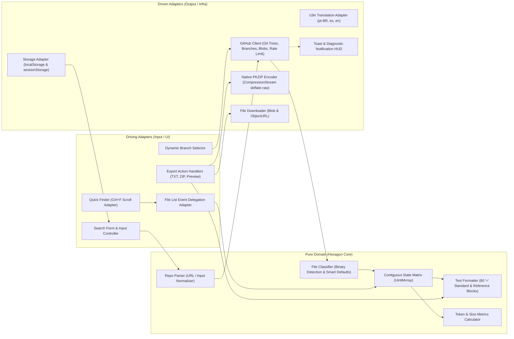

**🇺🇸 English** | [🇧🇷 Português (Brasil)](./README.pt-BR.md) | [🇪🇸 Español](./README.es.md)

---

# 🚀 GitHub Scrap

> **A 100% client-side, zero-dependency web application (HTML5, CSS3, and Vanilla JavaScript ES Modules) ready for GitHub Pages to explore, select, and extract source code from GitHub repositories into a single `.txt` file (optimized for LLMs/AI), a native `.zip` archive, or a direct on-screen preview/copy interface.**

🌐 **Official Web App:** [https://passella.github.io/github-scrap/](https://passella.github.io/github-scrap/)

---

[](https://passella.github.io/github-scrap/)
[](LICENSE)
[](#-engineering-standards--invariants)
[](#-deployment-on-github-pages)
[](#-system-architecture-ports--adapters)
[](#11-extreme-performance-for-massive-repositories)

---

## 📌 Overview

Feeding Large Language Models (**LLMs** such as Claude, GPT-4o, Gemini, or DeepSeek) with the codebase of an entire repository is often hindered by common friction points:
* Context window pollution caused by unwanted binary files (images, fonts, binaries, `.zip` archives).
* Unnecessary bandwidth consumption and exhaustion of the GitHub API rate limit when attempting to download large files that provide zero semantic value.
* Complex CLI setups and heavy local runtimes (Node.js, Python, Docker) that cannot be executed in restricted environments.
* Corporate Data Loss Prevention (**DLP**) policies and security proxies that block direct file downloads.

**GitHub Scrap** solves these challenges with a lean, browser-native solution. It is a **100% static client-side web application** built with **semantic HTML5**, **modern CSS3**, and **Vanilla JavaScript (ES Modules)**, without any build step, bundler, or third-party dependency.

Running entirely inside the browser, GitHub Scrap queries repository trees in real time using the **GitHub Git Trees API**, applies intelligent classification to differentiate source code from references, and exports the selected assets into clean, delimiter-separated `.txt` documents, native `.zip` archives, or an interactive on-screen preview.

---

## ✨ Key Features

### 1. 🌐 100% Client-Side & Zero Dependencies
* Operates entirely in the browser using standard Web APIs (`fetch`, `CompressionStream`, `Blob`, `URL.createObjectURL`, `localStorage`, `sessionStorage`).
* No backend server, Node.js runtime, build step, or package manager (`npm`/`yarn`) required.
* Ready for instant hosting on static providers like **GitHub Pages**, Cloudflare Pages, Netlify, or Vercel.

### 2. 🌍 Automatic Multi-Language Detection
* Automatically detects the user's browser language on initial load (`pt-BR`, `es`, or `en`), defaulting gracefully to English (`en`).
* Provides dynamic UI translation across labels, placeholders, tooltips, dialogs, status badges, and error diagnostics.

### 3. 🌿 Dynamic Branch Selection & Live Switching
* Queries the GitHub Branches API (`GET /repos/{owner}/{repo}/branches`) to list all active branches in a custom, accessible dropdown.
* Seamlessly switch branches in real time; the file tree and selection state refresh automatically for the selected branch.
* Automatically resolves the default branch (`main`, `master`, or custom) when none is specified.

### 4. ⚡ Scrap vs. Reference Modes & Smart Defaults
Granular dual-mode extraction balances token efficiency and repository context:

| Mode | Download Behavior | Output Representation | Recommended For |
| :--- | :--- | :--- | :--- |
| **`Scrap` (Text)** | Downloads full raw text via `raw.githubusercontent.com` or GitHub Blobs API. | Full UTF-8 file content delimited by canonical 80-column headers. | Source code (`.js`, `.ts`, `.py`, `.go`, `.rs`, `.java`, etc.), docs (`.md`, `.txt`), configs (`.json`, `.yaml`). |
| **`Reference`** | Zero network downloads ($O(1)$). Uses Git Tree metadata directly. | Structured metadata block: path, file type, exact size, Git SHA hash, GitHub web link (`blob`), and raw download URL. | Binary assets, fonts, media, compressed archives, or massive files (`> 500 KB`). |

* **Smart Defaults Button:** In 1 click, automatically tags binary files (images, archives, executables) and any file exceeding **500 KB** as `Reference`, while keeping source code files in `Scrap` mode.
* **Interactive Extension Quick-Selection Chips (`#extension-chips-bar`):** Displays a compact horizontal bar in the file list header with the top 10 most frequent file extensions (e.g., `.js (24)`, `.css (4)`, `.md (3)`). Clicking any chip toggles the selection state of all files matching that extension at once, updating visual active states (`.extension-chip.active`), checkboxes, and footer counters in real time.
* **Null Byte Guard:** Automatically scans downloaded text streams for null bytes (`\0`) and intercepts binary content, preventing corrupt text outputs.
* **Granular & Batch Toggles:** Toggle individual files between Scrap and Reference with a single click, or apply batch actions across the entire repository.

### 5. 🔍 Quick Finder (`Ctrl+F` / `Cmd+F` with Centered Smooth Scrolling)
* Keyboard shortcut `Ctrl+F` (or `Cmd+F`) shifts focus instantly to the sticky search bar (`#file-filter-input` when a repository is loaded, or `#search-input` otherwise).
* Locates matching files in the active list and smoothly centers them in the viewport (`scrollIntoView({ block: 'center', behavior: 'smooth' })`) combined with CSS `scroll-padding-block` / `scroll-margin-block`, ensuring matched items are never obscured behind the sticky header or sticky footer.
* Navigate forward and backward between occurrences using `Enter` and `Shift+Enter`.

### 6. 📊 Real-Time Size & AI Token Estimation
* Dynamic HUD in the sticky footer calculates and displays:
  * **Selected Files:** Real-time count of active files (distinguishing Scrap vs. Reference).
  * **Estimated Output Size:** Accurate mathematical projection (`B`, `KB`, `MB`, `GB`) of the final concatenated text output.
  * **Estimated LLM Tokens:** Real-time token approximation calculated based on character-to-token ratios, enabling precise prompt engineering.

### 7. 📦 3 Export Options, Off-Main-Thread Worker & Global Keyboard Shortcuts
Designed to work across both personal machines and restricted enterprise environments with **0ms main-thread blocking** via [`src/adapters/export-worker.js`](./src/adapters/export-worker.js):

1. **Generate TXT (`Ctrl+Shift+S` / `Cmd+Shift+S`):** Formats and saves `<repo>.txt` containing all selected files delimited with canonical 80-character headers inside a dedicated Web Worker (`TextFormatter.buildOutputDocument`). Uses the native **File System Access API** (`window.showSaveFilePicker` + `FileSystemWritableFileStream`) for direct-to-disk streaming when supported, with automatic fallback to `Blob` + `<a download>`.
2. **Generate ZIP (`Ctrl+Shift+Z` / `Cmd+Shift+Z`):** Packages selected files into a standard `.zip` archive preserving the original repository directory structure inside a dedicated Web Worker (`ZipEncoder.encode` with zero-copy `Transferable` `ArrayBuffer`), powered by browser-native `CompressionStream('deflate-raw')` and native `showSaveFilePicker` streaming (with transparent fallback).
3. **Preview / Copy (`Ctrl+Shift+P` / `Cmd+Shift+P`):** Opens the compiled output in an accessible modal dialog (`<dialog>`), featuring:
   * **1-Click Copy All:** Copies the entire output directly to the system clipboard.
   * **Open in New Tab:** Streams the content into a dedicated browser tab via a temporary `Blob` URL, allowing users in corporate environments with strict DLP download blocks to inspect and save the text without triggering file download alerts.

### 8. 🔑 Multi-Profile GitHub Token Manager & Encrypted Backup
* **Higher Rate Limits & Private Repositories:** Increases the GitHub REST API limit from **60 requests/hour** to **5,000 requests/hour** and enables browsing/extracting private repositories via the GitHub Blobs API (`GET /repos/{owner}/{repo}/git/blobs/{sha}`) with Base64 decoding.
* **Multi-Profile Management:** Save, name, switch between, and delete multiple GitHub PAT profiles (e.g., *Work*, *Personal*) with a 1-click generator link pre-populated with `repo,read:user` scopes.
* **Live Token Validation & Expiration Alerts:** Validates tokens in real time against `GET /user`, displaying visual status indicators (`valid`, `expiring`, `invalid`, `unverified`), authenticated `@username`, granted OAuth scopes, live rate-limit telemetry, and proactive warnings when a token is close to expiring.
* **Encrypted Backup & Restore (Web Crypto API):** Export and import saved token profiles as password-protected JSON files encrypted in the browser using **`PBKDF2-SHA256`** (100,000 iterations, random 16-byte salt) and **`AES-256-GCM`** (random 12-byte IV) in [`src/adapters/crypto-adapter.js`](./src/adapters/crypto-adapter.js).
* **Client-Only Storage:** Tokens are stored exclusively in the browser's `localStorage` and sent directly to `api.github.com`.

### 9. 📲 Full Offline-Capable Progressive Web App (PWA)
* **Installable Native Experience:** Includes [`manifest.json`](./manifest.json), vector icon [`favicon.svg`](./favicon.svg), and a discrete **`#install-pwa-button`** in the top bar that automatically appears when the browser fires `beforeinstallprompt`.
* **Offline App Shell Service Worker ([`sw.js`](./sw.js)):** Caches the complete application shell (`index.html`, `style.css`, `app.js`, `manifest.json`, `favicon.svg`, and all ES Modules under `src/`) using a **Stale-While-Revalidate** strategy for instant offline startup, while enforcing **Network-Only** for `api.github.com` and `raw.githubusercontent.com`.

### 10. 💾 Smart Persistence, Compressed IndexedDB Offline Cache & Multi-Tab Sync
* **URL & Branch Persistence:** Automatically saves the last queried repository and remembers file selection and mode preferences per `owner/repo@branch` in `localStorage`.
* **Compressed IndexedDB Offline Tree Cache ([`src/adapters/tree-cache-adapter.js`](./src/adapters/tree-cache-adapter.js)):** Persists repository metadata, branch lists, and full Git Trees (`owner/repo@branch`) in `IndexedDB` (`github-scrap-cache` / `git-trees`) compressed with `CompressionStream('gzip')` / `DecompressionStream('gzip')` (with 24h online TTL and automatic unlimited offline snapshot fallback when the network is unreachable).
* **Real-Time Multi-Tab Synchronization:** Synchronizes active GitHub Token profile changes, profile additions/deletions, and live API Rate Limit badges across all open browser tabs via `BroadcastChannel('github-scrap:sync')` and `window.addEventListener('storage')`.

### 11. 🏎️ Extreme Performance for Massive Repositories
Engineered to handle repositories with tens of thousands of files:
* **Contiguous Memory (`Uint8Array`):** File selection and extraction modes are indexed in contiguous typed arrays (`Uint8Array`), achieving $O(1)$ reads/writes with negligible memory overhead.
* **Event Delegation:** A single centralized event listener on `#file-list` handles all user interactions across thousands of rows.
* **Batch DOM Updates:** Builds list items off-screen using `DocumentFragment`, triggering only a single browser reflow and repaint.
* **CSS Virtualization:** Employs `content-visibility: auto` and `contain-intrinsic-size` to skip rendering of off-screen list elements, maintaining a fluid 60/120 FPS scroll experience.
* **Controlled Concurrency Pool:** Downloads are throttled through a 6-worker concurrency pool, preventing browser HTTP connection exhaustion while maintaining strict file ordering.
* **Dedicated Export Web Worker ([`src/adapters/export-worker.js`](./src/adapters/export-worker.js)):** Executes heavy PKZIP binary encoding (`ZipEncoder.encode` with zero-copy `[zipBytes.buffer]` `Transferable`) and massive text document compilation (`TextFormatter.buildOutputDocument`) off the main thread, with automatic in-thread fallback when `Worker` is unavailable.
* **Atomic Cancellation:** Integrated with `AbortController` to terminate all active network requests when a new search or branch switch occurs.

---

## 🏗️ System Architecture (Ports & Adapters)

GitHub Scrap is structured following the **Hexagonal Architecture (Ports & Adapters)** pattern and Clean Architecture principles, ensuring pure business logic is completely isolated from browser APIs and network infrastructure.



### Component Breakdown

| Layer | Module / File | Responsibility |
| :--- | :--- | :--- |
| **Presentation** | [`index.html`](./index.html) | Semantic HTML5 structure with accessible forms, progress indicator, PWA install button (`#install-pwa-button`), and dialog modals. |
| **Presentation** | [`style.css`](./style.css) | Responsive CSS3 styling with sticky toolbars, `scroll-padding-block` / `scroll-margin-block`, and grid alignment. |
| **PWA / Offline** | [`manifest.json`](./manifest.json) / [`sw.js`](./sw.js) / [`favicon.svg`](./favicon.svg) | Web App Manifest, vector icon, and Service Worker caching App Shell with Stale-While-Revalidate. |
| **Composition Root** | [`app.js`](./app.js) | Main application entry point, Service Worker registration, dependency wiring, and runtime event coordination. |
| **Pure Domain** | [`src/domain/repo-parser.js`](./src/domain/repo-parser.js) | Validates, normalizes, and parses repository inputs (`owner/repo`, web URLs, git URLs, branches). |
| **Pure Domain** | [`src/domain/file-classifier.js`](./src/domain/file-classifier.js) | Deterministic binary file classification, null-byte checks, and Smart Defaults evaluation. |
| **Pure Domain** | [`src/domain/text-formatter.js`](./src/domain/text-formatter.js) | Generates canonical 80-column delimited output, reference blocks, and token estimations. |
| **Driven Adapter** | [`src/adapters/i18n.js`](./src/adapters/i18n.js) | Multi-language translation dictionaries and browser locale detection (`pt-BR`, `es`, `en`). |
| **Driven Adapter** | [`src/adapters/github-client.js`](./src/adapters/github-client.js) | HTTP communication with GitHub REST API (trees, branches, blobs, token validation, rate limit telemetry). |
| **Driven Adapter** | [`src/adapters/zip-encoder.js`](./src/adapters/zip-encoder.js) | Native binary PKZIP encoder with CRC-32 and streaming `deflate-raw` compression. |
| **Driven Adapter** | [`src/adapters/export-worker.js`](./src/adapters/export-worker.js) | Dedicated Module Web Worker and client with `Transferable` zero-copy ZIP encoding and text formatting (plus in-thread fallback). |
| **Driven Adapter** | [`src/adapters/storage-adapter.js`](./src/adapters/storage-adapter.js) | Fault-tolerant persistence wrapper for `localStorage`, multi-profile token state, and multi-tab `BroadcastChannel` sync. |
| **Driven Adapter** | [`src/adapters/tree-cache-adapter.js`](./src/adapters/tree-cache-adapter.js) | Compressed `IndexedDB` (`CompressionStream('gzip')`) offline cache for Git Trees and branches with automatic fallback. |
| **Driven Adapter** | [`src/adapters/crypto-adapter.js`](./src/adapters/crypto-adapter.js) | Browser-native Web Crypto API adapter (`PBKDF2-SHA256` + `AES-256-GCM`) for encrypted profile backups. |
| **Driving Adapter** | [`src/adapters/dom-controller.js`](./src/adapters/dom-controller.js) | DOM event handling, extension chips (`#extension-chips-bar`), `Ctrl+Shift+S/Z/P` shortcuts, centered quick finder, `showSaveFilePicker`, and modals. |

---

## 📄 Output Specification (`<repo>.txt`)

The generated text file adheres to a standardized structure with **80-character `=` separator lines** (`================================================================================`), ensuring seamless ingestion by LLMs and automated parsers.

### 1. Scrap Mode Example (`FILE: <path>`)
```text
================================================================================
FILE: src/domain/calculator.js
================================================================================
export function add(a, b) {
  return a + b;
}

export function multiply(a, b) {
  return a * b;
}
```

### 2. Reference Mode Example (`FILE: <path> [MODE: REFERENCE]`)
```text
================================================================================
FILE: assets/architecture.png [MODE: REFERENCE]
================================================================================
Path: assets/architecture.png
Type: .png
Size: 148.5 KB (152064 bytes)
SHA: 4b825dc642cb6eb9a060e54bf8d69288fbee4904
GitHub View: https://github.com/owner/repo/blob/main/assets/architecture.png
Download Raw: https://raw.githubusercontent.com/owner/repo/main/assets/architecture.png
================================================================================
```

---

## 💻 How to Run Locally

Since the application is 100% static and relies on standard ES Modules, you only need a local HTTP server to avoid CORS restrictions on `file://` URLs.

### Using Python 3
```bash
python3 -m http.server 8000
```
Open your browser at: `http://localhost:8000`

### Using Node.js (`npx`)
```bash
npx serve .
```

### Using PHP CLI
```bash
php -S localhost:8000
```

---

## 🌐 Deployment on GitHub Pages

The application is deployed and publicly accessible at:
```
https://passella.github.io/github-scrap/
```

To deploy your own instance to **GitHub Pages**:

1. Push the repository to GitHub.
2. In your GitHub repository, navigate to **Settings** > **Pages**.
3. Under **Build and deployment**:
   * **Source**: Select `Deploy from a branch`.
   * **Branch**: Select `main` (or `master`) and folder `/(root)`.
4. Click **Save**.
5. Within moments, your application will be live at:
   ```
   https://passella.github.io/github-scrap/
   ```

---

## 📐 Engineering Standards & Invariants

This codebase strictly follows modern software engineering principles and the invariants defined in **`agent-dev-base`**:

1. **Strict SOLID Principles:**
   * **SRP:** Domain functions handle a single discrete operation.
   * **OCP:** Output formatters and classifier rules are open for extension without modifying core logic.
   * **DIP:** Pure business rules have zero coupling to browser globals or network implementations.
2. **Hexagonal Architecture (Ports & Adapters):**
   * Absolute isolation of pure domain logic (`src/domain/`) from transport, storage, and UI adapters (`src/adapters/`).
3. **KISS & DRY:**
   * Zero external npm packages, zero build dependencies, zero frameworks.
   * Single Source of Truth (SSOT) for all path normalizations, token math, and formatting rules.
4. **Extreme Performance & Volumetry:**
   * $O(1)$ state lookups using contiguous typed memory (`Uint8Array`).
   * Event delegation and CSS virtualization (`content-visibility: auto`) for silky smooth 60 FPS rendering.
   * Controlled 6-worker network concurrency pool with atomic `AbortController` cancellation.
5. **Zero Source Code Comments:**
   * 100% self-descriptive code through strict typing, expressive domain naming, and clean architectural boundaries.

---

## 📄 License

This project is licensed under the terms of the **MIT License**. See the [LICENSE](LICENSE) file for details.
