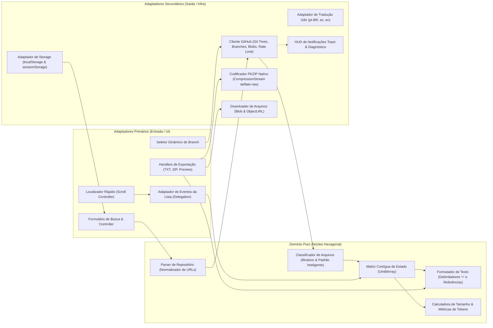

[🇺🇸 English](./README.md) | **🇧🇷 Português (Brasil)** | [🇪🇸 Español](./README.es.md)

---

# 🚀 GitHub Scrap

> **Aplicação web 100% client-side e zero-dependência (HTML5, CSS3 e Vanilla JavaScript ES Modules) pronta para GitHub Pages para explorar, selecionar e extrair código-fonte de repositórios GitHub em um único arquivo `.txt` (otimizado para LLMs/IA), arquivo `.zip` nativo ou visualização/cópia direta na tela.**

🌐 **Acessar Aplicação:** [https://passella.github.io/github-scrap/](https://passella.github.io/github-scrap/)

---

[](https://passella.github.io/github-scrap/)
[](LICENSE)
[](#-padrões-de-engenharia--invariantes)
[](#-deploy-no-github-pages)
[](#-arquitetura-do-sistema-ports--adapters)
[](#11-extrema-performance-para-alta-volumetria)

---

## 📌 Visão Geral

Alimentar Modelos de Linguagem de Grande Escala (**LLMs** como Claude, GPT-4o, Gemini ou DeepSeek) com o código-fonte de repositórios inteiros frequentemente esbarra em obstáculos operacionais:
* Poluição da janela de contexto com arquivos binários desnecessários (imagens, fontes, executáveis e arquivos compactados `.zip`).
* Desperdício de largura de banda e esgotamento prematuro do limite de requisições da API do GitHub ao tentar baixar arquivos pesados que não agregam valor semântico.
* Complexidade desnecessária de ferramentas CLI locais e ambientes de execução pesados (Node.js, Python, Docker) inviáveis em máquinas corporativas restritas.
* Políticas corporativas de Prevenção contra Perda de Dados (**DLP**) e proxies de segurança que bloqueiam o download direto de arquivos.

O **GitHub Scrap** resolve esses gargalos com uma solução enxuta, elegante e 100% nativa do navegador. Trata-se de uma aplicação web **estática client-side**, construída com **HTML5 semântico**, **CSS3 moderno** e **Vanilla JavaScript (ES Modules)**, sem frameworks, empacotadores (bundlers) ou qualquer dependência externa.

Executando diretamente no navegador do usuário, o GitHub Scrap consulta árvores de arquivos do GitHub em tempo real via **GitHub Git Trees API**, classifica inteligentemente arquivos de texto versus referências estruturadas e exporta os dados selecionados em documentos `.txt` padronizados, arquivos `.zip` nativos ou em um visualizador integrado na tela.

---

## ✨ Principais Funcionalidades

### 1. 🌐 100% Client-Side & Zero Dependências
* Funciona integralmente no navegador utilizando Web APIs padronizadas (`fetch`, `CompressionStream`, `Blob`, `URL.createObjectURL`, `localStorage`, `sessionStorage`).
* Sem necessidade de servidor backend, runtime Node.js, build step ou gerenciadores de pacotes (`npm`/`yarn`).
* Pronto para deploy imediato em plataformas estáticas como **GitHub Pages**, Cloudflare Pages, Netlify ou Vercel.

### 2. 🌍 Detecção Automática de Idioma (Multi-idiomas)
* Detecta automaticamente o idioma configurado no navegador do usuário no carregamento inicial (`pt-BR`, `es` ou `en`), adotando o inglês (`en`) como fallback padrão.
* Tradução dinâmica de toda a interface: rótulos, campos de busca, modais, tooltips, notificações e diagnósticos de erro.

### 3. 🌿 Seleção de Branch Dinâmica em Tempo Real
* Consulta dinamicamente a API de branches do GitHub (`GET /repos/{owner}/{repo}/branches`) e lista todas as branches ativas em um dropdown acessível.
* Permite alternar branches em tempo real, recarregando a árvore de arquivos e restaurando as preferências de seleção específicas daquela branch.
* Identifica automaticamente a branch padrão (`main`, `master` ou personalizada) quando omitida na URL de busca.

### 4. ⚡ Modos Scrap vs. Referência & Padrão Inteligente
Extração híbrida que equilibra o consumo de contexto de IA e o tráfego de rede:

| Modo | Comportamento no Download | Formato no Arquivo Compilado | Cenário Recomendado |
| :--- | :--- | :--- | :--- |
| **`Scrap` (Texto)** | Realiza download do código bruto via `raw.githubusercontent.com` ou API de Blobs. | Conteúdo integral UTF-8 delimitado por cabeçalhos padronizados de 80 colunas. | Código-fonte (`.js`, `.ts`, `.py`, `.go`, `.rs`, `.java`, etc.), documentação (`.md`, `.txt`) e configs (`.json`, `.yaml`). |
| **`Referência`** | Zero requisições de download ($O(1)$). Extrai os metadados diretamente da árvore do Git. | Bloco estruturado com caminho, tipo, tamanho exato em bytes, hash SHA do Git blob, link de visualização web (`blob`) e link direto de download (`raw`). | Arquivos binários, fontes, mídias, arquivos compactados ou arquivos gigantescos (`> 500 KB`). |

* **Botão Padrão Inteligente:** Com 1 clique, marca automaticamente arquivos binários e arquivos maiores que **500 KB** como `Referência`, mantendo todo o código-fonte em modo `Scrap`.
* **Chips Interativos de Seleção Rápida por Extensão (`#extension-chips-bar`):** Exibe no cabeçalho da lista de arquivos uma barra horizontal compacta com as 10 extensões mais frequentes do repositório carregado (ex: `.js (24)`, `.css (4)`, `.md (3)`). Clicar em um chip alterna instantaneamente a seleção de todos os arquivos daquela extensão, atualizando o estado visual ativo (`.extension-chip.active`), os checkboxes e os contadores do rodapé.
* **Proteção contra Bytes Nulos:** Examina o fluxo de texto baixado e intercepta caracteres nulos (`\0`), prevenindo a inserção acidental de binários corrompidos no arquivo final.
* **Controle Granular e em Lote:** Permite alternar arquivos individualmente entre Scrap e Referência ou aplicar ações em lote a todos os arquivos listados.

### 5. 🔍 Localizador Rápido (`Ctrl+F` / `Cmd+F` com Rolagem Centralizada Suave)
* O atalho `Ctrl+F` (ou `Cmd+F`) foca instantaneamente na barra de busca rápida (`#file-filter-input` quando um repositório está carregado, ou `#search-input` caso contrário).
* Localiza o arquivo na lista ativa e rola suavemente centralizando-o na viewport (`scrollIntoView({ block: 'center', behavior: 'smooth' })`) em conjunto com `scroll-padding-block` e `scroll-margin-block`, garantindo que nenhum item encontrado fique oculto atrás do cabeçalho ou rodapé fixos.
* Permite navegar sequencialmente entre os resultados encontrados utilizando `Enter` (próximo) e `Shift+Enter` (anterior).

### 6. 📊 Estimativa em Tempo Real de Tamanho e Tokens para IA
* Painel HUD dinâmico no rodapé sticky calcula e exibe em tempo real:
  * **Arquivos Selecionados:** Contagem total discriminando arquivos em modo Scrap vs. Referência.
  * **Tamanho Estimado:** Projeção matemática precisa do tamanho final compilado (`B`, `KB`, `MB`, `GB`).
  * **Tokens Estimados para LLMs:** Cálculo em tempo real baseado na densidade média de caracteres por token, facilitando o dimensionamento exato do contexto para prompts de IA.

### 7. 📦 3 Formas de Exportação, Web Worker Dedicado & Atalhos Globais
Projetado para operar com **0ms de bloqueio da main thread** via [`src/adapters/export-worker.js`](./src/adapters/export-worker.js) tanto em computadores pessoais quanto em ambientes corporativos restritos:

1. **Gerar TXT (`Ctrl+Shift+S` / `Cmd+Shift+S`):** Compila e salva o arquivo `<repo>.txt` em um Web Worker dedicado (`TextFormatter.buildOutputDocument`) contendo todos os arquivos selecionados separados por cabeçalhos canônicos de 80 colunas. Utiliza a **File System Access API** nativa (`window.showSaveFilePicker` + `FileSystemWritableFileStream`) para gravação direta em disco quando disponível, com fallback transparente para `Blob` + `<a download>`.
2. **Gerar ZIP (`Ctrl+Shift+Z` / `Cmd+Shift+Z`):** Empacota os arquivos selecionados preservando a estrutura original de diretórios do repositório em um Web Worker dedicado (`ZipEncoder.encode` com `Transferable` zero-copy), utilizando `CompressionStream('deflate-raw')` e gravação direta via `showSaveFilePicker` (com fallback automático).
3. **Visualizar / Copiar (`Ctrl+Shift+P` / `Cmd+Shift+P`):** Abre o resultado compilado em um diálogo modal acessível (`<dialog>`), oferecendo:
   * **Copiar Tudo:** Copia todo o conteúdo compilado diretamente para a área de transferência em 1 clique.
   * **Abrir em Nova Aba:** Transmite o conteúdo para uma nova aba do navegador via URL temporária `Blob`, permitindo que usuários em redes corporativas com bloqueio de download (DLP) visualizem e salvem o texto sem acionar filtros de segurança.

### 8. 🔑 Gerenciador Multi-Perfil de Tokens GitHub & Backup Criptografado
* **Limite Expandido & Repositórios Privados:** Eleva o teto da API REST do GitHub de **60 requisições/hora** para **5.000 requisições/hora** e permite acessar repositórios privados via API de Blobs (`GET /repos/{owner}/{repo}/git/blobs/{sha}`) com decodificação Base64.
* **Gerenciamento Multi-Perfil:** Salve, nomeie, alterne e exclua múltiplos perfis de Personal Access Token (ex: *Trabalho*, *Pessoal*) com link direto para geração no GitHub com escopos `repo,read:user` pré-selecionados.
* **Validação Real & Alerta de Expiração:** Valida tokens em tempo real contra `GET /user`, exibindo indicador visual de status/validade (`valid`, `expiring`, `invalid`, `unverified`), usuário autenticado (`@username`), escopos ativos, badge de rate-limit na barra superior e alerta proativo quando o token está próximo de expirar.
* **Backup e Restauração Criptografada (Web Crypto API):** Exporte e importe seus perfis de token em arquivos JSON protegidos por senha com criptografia autenticada no navegador via **`PBKDF2-SHA256`** (100.000 iterações + salt aleatório de 16 bytes) e **`AES-256-GCM`** (IV aleatório de 12 bytes) em [`src/adapters/crypto-adapter.js`](./src/adapters/crypto-adapter.js).
* **Armazenamento 100% Local:** Os tokens ficam salvos exclusivamente no `localStorage` do navegador e são enviados diretamente para `api.github.com`.

### 9. 📲 Suporte PWA Offline Completo (Progressive Web App)
* **Instalação Nativa:** Inclui [`manifest.json`](./manifest.json), ícone vetorial [`favicon.svg`](./favicon.svg) e o botão discreto **`#install-pwa-button`** na barra superior, exibido automaticamente quando o navegador dispara o evento `beforeinstallprompt`.
* **Service Worker de App Shell Offline ([`sw.js`](./sw.js)):** Realiza o precache de toda a estrutura da aplicação (`index.html`, `style.css`, `app.js`, `manifest.json`, `favicon.svg` e todos os módulos em `src/`) utilizando a estratégia **Stale-While-Revalidate** para assets estáticos e **Network-Only** para `api.github.com` e `raw.githubusercontent.com`.

### 10. 💾 Persistência Inteligente, Cache Offline IndexedDB Compactado & Sincronia Multi-Aba
* **Persistência de URL e Estado por Branch:** Armazena o último repositório consultado e memoriza as seleções e modos por repositório e branch (`owner/repo@branch`) no `localStorage`.
* **Cache Offline de Árvores Git via IndexedDB Compactado ([`src/adapters/tree-cache-adapter.js`](./src/adapters/tree-cache-adapter.js)):** Persiste metadados, branches e árvores Git completas (`owner/repo@branch`) no `IndexedDB` (`github-scrap-cache` / `git-trees`) compactadas com `CompressionStream('gzip')` / `DecompressionStream('gzip')` (com TTL online de 24h e fallback offline automático ilimitado caso a rede esteja indisponível).
* **Sincronização em Tempo Real Entre Abas:** Sincroniza instantaneamente entre todas as abas abertas a troca/adição/remoção de perfis de Token GitHub e a atualização do badge de Rate Limit via `BroadcastChannel('github-scrap:sync')` e `window.addEventListener('storage')`.

### 11. 🏎️ Extrema Performance para Alta Volumetria
Otimizado para processar repositórios massivos contendo dezenas de milhares de arquivos:
* **Matriz Contígua em Memória (`Uint8Array`):** Estado de seleção e modo de cada arquivo gerenciados em arrays tipados contíguos de memória (`Uint8Array`), garantindo leitura e gravação em tempo estrito $O(1)$ sem sobrecarga de Garbage Collector.
* **Delegação Centralizada de Eventos:** Um único ouvinte no container `#file-list` gerencia todas as interações do usuário em milhares de linhas.
* **Renderização em Lote:** Montagem de elementos fora da árvore principal do DOM via `DocumentFragment`, gerando um único reflow e repaint no navegador.
* **Virtualização com CSS Moderno:** Utiliza `content-visibility: auto` e `contain-intrinsic-size` para evitar o cálculo de layout de nós fora da viewport, mantendo rolagem a 60/120 FPS.
* **Pool Concorrente Limitado:** Fila de downloads controlada por 6 workers paralelos, evitando o esgotamento de conexões HTTP do navegador e preservando a ordem canônica dos arquivos.
* **Web Worker Dedicado de Exportação ([`src/adapters/export-worker.js`](./src/adapters/export-worker.js)):** Executa em background a codificação binária PKZIP (`ZipEncoder.encode` com `Transferable` `[zipBytes.buffer]`) e a formatação de documento texto (`TextFormatter.buildOutputDocument`), mantendo a main thread com 0ms de bloqueio e fallback automático in-thread quando `Worker` não estiver disponível.
* **Cancelamento Atômico com `AbortController`:** Interrompe requisições de rede pendentes de forma imediata quando uma nova busca é disparada.

---

## 🏗️ Arquitetura do Sistema (Ports & Adapters)

O GitHub Scrap segue rigorosamente os preceitos da **Arquitetura Hexagonal (Ports & Adapters)** e os princípios de Clean Architecture, mantendo as regras de negócio do Domínio Puro completamente isoladas de APIs do navegador e da rede.



### Divisão de Componentes

| Camada | Módulo / Arquivo | Responsabilidade |
| :--- | :--- | :--- |
| **Apresentação** | [`index.html`](./index.html) | Marcação semântica HTML5 acessível com formulários, barra de progresso, botão de instalação PWA (`#install-pwa-button`) e diálogos modais. |
| **Apresentação** | [`style.css`](./style.css) | Estilização responsiva CSS3 com barras sticky, `scroll-padding-block` / `scroll-margin-block` e layout em CSS Grid. |
| **PWA / Offline** | [`manifest.json`](./manifest.json) / [`sw.js`](./sw.js) / [`favicon.svg`](./favicon.svg) | Web App Manifest, ícone vetorial e Service Worker de cache offline do App Shell (Stale-While-Revalidate). |
| **Composition Root** | [`app.js`](./app.js) | Ponto de entrada da aplicação, registro do Service Worker, inicialização de eventos e injeção de dependências. |
| **Domínio Puro** | [`src/domain/repo-parser.js`](./src/domain/repo-parser.js) | Validação sintática e normalização de entradas de repositório (`owner/repo`, URLs web, git, branches). |
| **Domínio Puro** | [`src/domain/file-classifier.js`](./src/domain/file-classifier.js) | Classificação determinística de extensões binárias, auditoria de null-bytes e Padrão Inteligente. |
| **Domínio Puro** | [`src/domain/text-formatter.js`](./src/domain/text-formatter.js) | Geração do texto final com separadores canônicos de 80 colunas, blocos de referência e estimativa de tokens. |
| **Adaptador Secundário** | [`src/adapters/i18n.js`](./src/adapters/i18n.js) | Dicionários de tradução multi-idiomas e detecção automática de locale (`pt-BR`, `es`, `en`). |
| **Adaptador Secundário** | [`src/adapters/github-client.js`](./src/adapters/github-client.js) | Comunicação HTTP com a API REST do GitHub (árvores, branches, blobs, validação de token e rate limit). |
| **Adaptador Secundário** | [`src/adapters/zip-encoder.js`](./src/adapters/zip-encoder.js) | Codificador binário PKZIP nativo com tabela CRC-32 e compressão streaming via `deflate-raw`. |
| **Adaptador Secundário** | [`src/adapters/export-worker.js`](./src/adapters/export-worker.js) | Module Web Worker dedicado e cliente com transferência zero-copy (`Transferable`) para ZIP e formatação TXT (com fallback in-thread). |
| **Adaptador Secundário** | [`src/adapters/storage-adapter.js`](./src/adapters/storage-adapter.js) | Abstração resiliente para persistência multi-perfil em `localStorage` e sincronização multi-aba via `BroadcastChannel`. |
| **Adaptador Secundário** | [`src/adapters/tree-cache-adapter.js`](./src/adapters/tree-cache-adapter.js) | Cache offline persistente em `IndexedDB` compactado via `CompressionStream('gzip')` para árvores Git e branches. |
| **Adaptador Secundário** | [`src/adapters/crypto-adapter.js`](./src/adapters/crypto-adapter.js) | Adaptador de criptografia autenticada via Web Crypto API (`PBKDF2-SHA256` + `AES-256-GCM`) para backup de perfis. |
| **Adaptador Primário** | [`src/adapters/dom-controller.js`](./src/adapters/dom-controller.js) | Gerenciador de eventos do DOM, chips de extensão (`#extension-chips-bar`), atalhos `Ctrl+Shift+S/Z/P`, escrita `showSaveFilePicker`, busca rápida e PWA. |

---

## 📄 Formato do Arquivo Gerado (`<repo>.txt`)

O documento compilado adota uma formatação padronizada com **separadores de 80 caracteres `=`** (`================================================================================`), facilitando a leitura estruturada por LLMs e rotinas de automação.

### 1. Exemplo de Bloco no Modo `Scrap` (`FILE: <caminho>`)
```text
================================================================================
FILE: src/domain/calculator.js
================================================================================
export function add(a, b) {
  return a + b;
}

export function multiply(a, b) {
  return a * b;
}
```

### 2. Exemplo de Bloco no Modo `Referência` (`FILE: <caminho> [REFERÊNCIA]`)
```text
================================================================================
FILE: assets/arquitetura.png [REFERÊNCIA]
================================================================================
Caminho: assets/arquitetura.png
Tipo: .png
Tamanho: 148.5 KB (152064 bytes)
SHA: 4b825dc642cb6eb9a060e54bf8d69288fbee4904
GitHub View: https://github.com/owner/repo/blob/main/assets/arquitetura.png
Download Raw: https://raw.githubusercontent.com/owner/repo/main/assets/arquitetura.png
================================================================================
```

---

## 💻 Como Executar Localmente

Sendo uma aplicação estática baseada em ES Modules, basta iniciar um servidor HTTP simples para evitar restrições de CORS em arquivos locais:

### Com Python 3
```bash
python3 -m http.server 8000
```
Abra no navegador: `http://localhost:8000`

### Com Node.js (`npx`)
```bash
npx serve .
```

### Com PHP CLI
```bash
php -S localhost:8000
```

---

## 🌐 Deploy no GitHub Pages

A aplicação está publicada e acessível publicamente em:
```
https://passella.github.io/github-scrap/
```

Para publicar sua própria instância no **GitHub Pages**:

1. Suba o repositório para sua conta no GitHub.
2. No repositório, acesse a aba **Settings** > **Pages**.
3. Na seção **Build and deployment**:
   * **Source**: Selecione `Deploy from a branch`.
   * **Branch**: Selecione `main` (ou `master`) e a pasta `/(root)`.
4. Clique em **Save**.
5. Em poucos instantes, a aplicação estará disponível publicamente em:
   ```
   https://passella.github.io/github-scrap/
   ```

---

## 📐 Padrões de Engenharia & Invariantes

O desenvolvimento segue com rigor as diretrizes de excelência em engenharia e os invariantes de **`agent-dev-base`**:

1. **Princípios SOLID Rigorosos:**
   * **SRP:** Funções do domínio puramente focadas em uma única responsabilidade atômica.
   * **OCP:** Módulos de formatação e classificadores abertos para extensão sem alteração no núcleo.
   * **DIP:** Domínio puro sem qualquer acoplamento a APIs globais do navegador ou detalhes de rede.
2. **Arquitetura Hexagonal (Ports & Adapters):**
   * Isolamento completo das regras de negócio (`src/domain/`) em relação aos adaptadores de infraestrutura e interface (`src/adapters/`).
3. **KISS & DRY:**
   * Zero pacotes externos npm, zero dependências de build, zero frameworks desnecessários.
   * Ponto Único da Verdade (SSOT) para cálculos de métricas de tokens, parsing de caminhos e constantes.
4. **Extrema Performance & Volumetria:**
   * Acesso e escrita em tempo $O(1)$ utilizando matriz de estado contígua (`Uint8Array`).
   * Delegação de eventos e virtualização CSS (`content-visibility: auto`) para fluidez estável a 60/120 FPS.
   * Pool de concorrência com 6 workers assíncronos e cancelamento atômico via `AbortController`.
5. **Código 100% Autodescritivo (Zero Comentários):**
   * Código expressivo, fundamentado em tipagem contextual semântica e limites arquiteturais nítidos.

---

## 📄 Licença

Este projeto é distribuído sob os termos da licença **MIT**. Consulte o arquivo [LICENSE](LICENSE) para mais informações.
